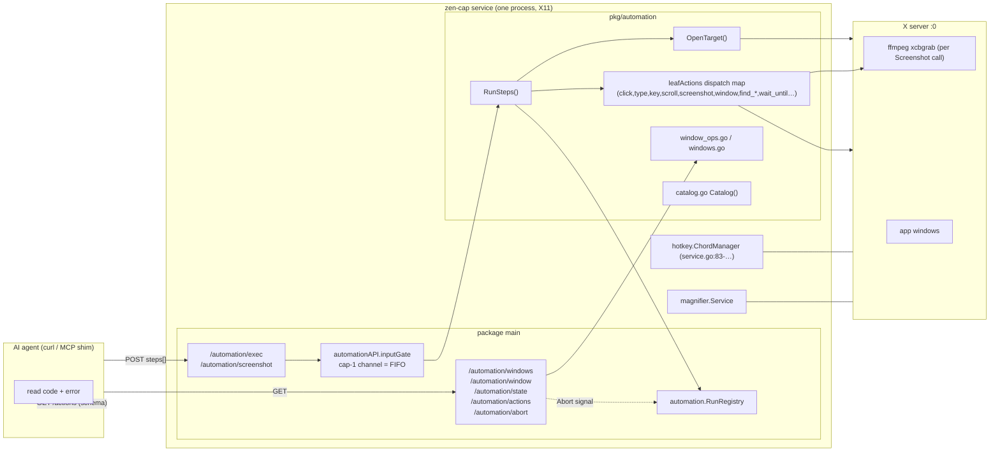
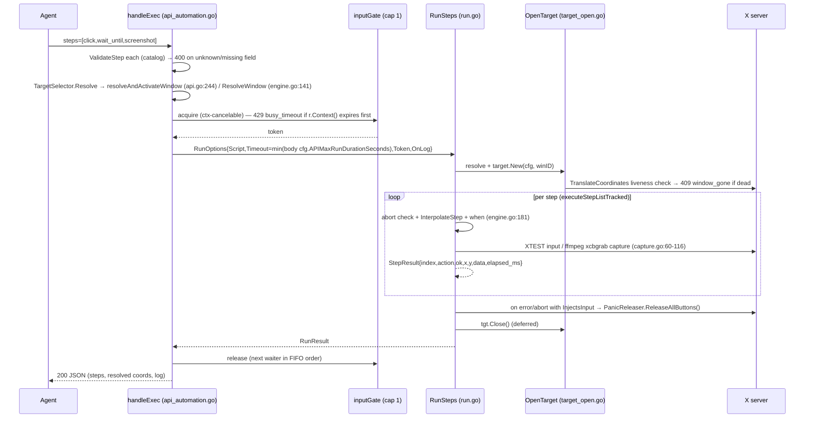

# ARCHITECTURE PLAN — `/automation` HTTP API (vision-driven screen interaction for AI agents)

**Slug:** `automation-http-api`
**Repo root:** `/media/jang/home/Deve/zen-cap` · **Server:** `http://localhost:4444` (X11 only; Wayland cannot be automated — no XTEST)
**HARD PREREQUISITE (Phase 0):** `ARCHITECTURE_PLAN_x11-coordinate-and-engine-fixes.md` must be fully landed before Phase 3 step **A6** and **A9** below. Steps A1–A3 can start in parallel with Phase 0.

---

## Summary

`zen-cap` already contains a complete, tested desktop-automation engine (`pkg/automation`: `ExecuteStep` at `actions.go:48`, `RunScript` at `engine.go:22`, `target.Target` at `pkg/target/target.go:20-44`) and a running HTTP daemon whose API today only exposes `POST /screenshot` and `POST /collaborate` (`api.go:89`, `api.go:115`). This plan exposes that engine over HTTP so an AI coding agent can *drive* the app it is debugging — enumerate/activate/resize/fullscreen a window, double-click to trigger a fullscreen transition, type into a field it located in a screenshot, scroll a list, take the next screenshot, read back window state — instead of asking a human to click for it. The design is **stateless by choice** (no session registry, no TTL sweeper): every request names its target window, reuses `target.New(...)` + `ResolveWindow` exactly as YAML scripts do, and the response returns the resolved window id and every matched coordinate so the agent can thread state itself. One write surface (`POST /automation/exec`, a batch of the *existing* `automation.Step` JSON) plus four read surfaces, all funnelling through one shared gate so two simultaneous runs can never interleave synthetic pointer events. Four new engine actions (`scroll`, `screenshot`, `wait_until`, `window_state`) and `clicks: N` on `click` close the gaps found while designing this; a machine-readable action catalog (`GET /automation/actions`) keeps the API self-describing for agents that never read a doc.

---

## Boundaries

**In scope:** HTTP surface, request→engine bridge, run registry, action catalog, four new engine actions, config keys, docs, smoke script.
**Explicitly out of scope (user decisions):** authentication/authorization (daemon binds `localhost`, single trusted user); persistent sessions/variable storage across requests; pipeline side-effects on automation captures; suppressing the daemon's own global hotkeys while an agent types; focus verification before `type` (handled instead by API ergonomics — see **A4 `activate`-before-click** and the golden path at the end).

**Reused, not rewritten:** `automation.Step`/`Script` (`pkg/automation/types.go:9,52`), `executeStepWithControl` (`engine.go:181` — the only place interpolation + `loop/if_found/if_pixel/if_window/var/call` live; calling `ExecuteStep` directly would silently drop `if_found` as `unknown action`), `ResolveWindow` (`engine.go:141`), `target.New` (`pkg/target/target.go:84`), `screenPoller` (Phase 0), `pkg/display` window enumeration (`pkg/display/x11.go:81-137`), `resolveAndActivateWindow` (`api.go:244-331`), `capture.SavePNG`, `parseWindowID` (`helpers.go:83`, already accepts `0x…` and decimal).



`pkg/automation` never imports `net/http`; package `main` never calls `xtest`/`xproto` directly for automation routes. That is the testability boundary: everything below the HTTP handlers runs under `go test ./pkg/automation/...`.

---

## Wire contracts

Envelope stays backward compatible with the existing API: success → `{"status":"success", …}`; failure → `{"error":"…","code":"…"}` (`api.go:100` today returns only `error`; adding `code` is additive).

| Method · Path | Request | Response | Notes |
|---|---|---|---|
| `GET /automation/actions` | – | `{"status":"success","actions":[ActionSpec…],"step_schema":{json field names of automation.Step}}` | Self-description; **the** thing an agent reads first |
| `POST /automation/exec` | `{"window":"gnome-terminal" \| "0x400001" \| "active", "window_id":"0x…", "pid":123, "class":"", "title":"", "launch":"firefox --new-window", "display":":0", "steps":[Step…], "timeout":"30s", "stop_on_error":true, "no_activate":false}` | `{"status":"success","ok":true,"run_id":"r7","window_id":4194305,"window_title":"…","window_class":"…","geometry":{"x":…,"y":…,"w":…,"h":…},"screen":[1920,1080],"steps":[{"index":0,"action":"click","ok":true,"elapsed_ms":12},{"index":1,"action":"find_text","ok":true,"x":812,"y":233,"data":{…}}],"variables":{…},"log":["[Automation] Step 1/2: click", …],"stopped":false}` | 400 `unknown_action`/`bad_request`; 403 `input_disabled`; 409 `window_gone`; 504 `timeout`; 500 `x_error`/`step_failed` |
| `POST /automation/screenshot` | target fields as above + `{"output":"/tmp/x.png","region":"0,0,800,600" \| "TLBR","inline":true}` | `{"status":"success","path":"/abs/x.png","width":800,"height":600,"bytes":41233,"mime":"image/png","base64":"…","encoding":"base64","truncated":false}` | **No pipeline** (no clipboard/upload/LLM/overlay), unlike `POST /screenshot` (`api.go:238`) |
| `GET /automation/windows` | – | `{"status":"success","active_window_id":…,"windows":[{"id":4194305,"id_hex":"0x400001","pid":31337,"class":"firefox","instance":"Firefox","title":"…","geometry":{…},"state":{"fullscreen":false,"maximized":true,"minimized":false,"states":["MAXIMIZED_HORZ","MAXIMIZED_VERT"]},"active":true}]}` | Viewable + untitled windows included (unlike `pkg/display/x11.go:100-105`) |
| `GET /automation/window?id=\|class=\|title=\|pid=` | – | `{"status":"success","window":{…WindowInfo…}}` | Read-back after any state-changing request |
| `GET /automation/state` | – | `{"status":"success","display":":0","screens":[…],"active_window":{…},"pointer":{"x":…,"y":…},"held_buttons":[],"deny_api_input":false,"active_runs":["r7"],"max_run_seconds":60}` | Cheap, never blocked by the gate |
| `POST /automation/abort` | – | `{"status":"success","aborted":2,"released_buttons":true}` | Cancels in-flight runs **and** force-releases pointer buttons; never queued behind the gate |

`Step` JSON == `automation.Step` (`pkg/automation/types.go:9`) verbatim, so every documented YAML action (`AUTOMATION_API.md:297-492`) works over HTTP with zero new translation code, including `{{var}}` interpolation and control flow **within one request**. Across requests there is no server state: `variables` come back in the response and the agent sends them forward in the next body — see **A2 `RunOptions.SeedVars`**.

### Data flow of one `POST /automation/exec`



**State management.** Server-side state is exactly three things: (a) `automationAPI.inputGate` (cap-1 channel, provides mutual exclusion *and* first-come-first-served ordering, unlike `sync.Mutex`), (b) `RunRegistry.runs` map of in-flight run tokens, (c) per-request `ExecContext` (variables + `LastFoundX/Y` + `LastResult`, discarded on response). No file writes other than screenshot PNGs under `cfg.OutputDir` / absolute paths the caller names. Nothing survives a restart, which makes `./run.sh`'s restart-on-save loop harmless.

---

## Implementation Blueprint

Pseudocode only; bodies are `// TODO: implement`. Field names/tags are the wire format and are normative.

| Step | File path | Action | Concrete signature / schema (pseudocode) | Depends on | Acceptance criteria ("done when…") |
|---|---|---|---|---|---|
| **A1** | `pkg/config/config.go` | **modify** | In `Config` (struct at `:125`, put beside `APIAddress` `:130`):<br>`DenyAPIInput bool \`json:"deny_api_input"\``<br>`APIMaxRunDurationSeconds int \`json:"api_max_run_duration_seconds"\``<br>`APIMaxInlineBytes int \`json:"api_max_inline_bytes"\``<br>Fixups needed in **three** places (not one): `DefaultConfig` (`:232`, near `:281`), `DefaultPortableConfig` (`:430`, near `:464`), `readConfig` (`:718`, follow the existing pattern at `:820-822` `if cfg.APIAddress == "" { cfg.APIAddress = defaults.APIAddress }`) → `if cfg.APIMaxRunDurationSeconds <= 0 { = 60 }`, `if cfg.APIMaxInlineBytes <= 0 { = 8388608 }`. Inverse polarity on the bool is deliberate: `json.Unmarshal` leaves an absent bool `false` = input allowed, so no sentinel needed. | – | New test `pkg/config/api_fields_test.go`: `LoadConfig` against the repo's existing `config.json` (which has none of the new keys, `config.json:37`) yields `DenyAPIInput==false`, `APIMaxRunDurationSeconds==60`, `APIMaxInlineBytes==8388608`; `go test ./pkg/config/...` green. **Gotcha to record in docs:** `./run.sh` watches `go mod sum yaml yml toml` only — editing `config.json` does NOT restart the daemon. |
| **A2** | `pkg/automation/run.go` | **create** | `type RunOptions struct { Script Script; Config *config.Config; ScriptDir string; SeedVars map[string]interface{}; Timeout time.Duration; StopOnError bool; OnLog func(format string, args ...interface{}) ; Token *RunToken }`<br>`type RunToken struct { ID string; Abort chan struct{}; StartedAt time.Time; cancelOnce sync.Once }`<br>`func NewRunToken(id string) *RunToken` · `func (t *RunToken) Cancel()` · `func (t *RunToken) Done() <-chan struct{}`<br>`type StepResult struct { Index int \`json:"index"\`; Action string \`json:"action"\`; OK bool \`json:"ok"\`; Error string \`json:"error,omitempty"\`; ElapsedMS int64 \`json:"elapsed_ms"\`; X int \`json:"x,omitempty"\`; Y int \`json:"y,omitempty"\`; Data json.RawMessage \`json:"data,omitempty"\` }`<br>`type RunResult struct { RunID string \`json:"run_id"\`; OK bool \`json:"ok"\`; Stopped bool \`json:"stopped,omitempty"\`; StoppedAt int \`json:"stopped_at,omitempty"\`; WindowID uint32 \`json:"window_id"\`; WindowTitle string \`json:"window_title"\`; WindowClass string \`json:"window_class"\`; Geometry WindowGeom \`json:"geometry"\`; ScreenW, ScreenH int \`json:"screen"\`; Steps []StepResult \`json:"steps"\`; Variables map[string]interface{} \`json:"variables,omitempty"\`; Log []string \`json:"log,omitempty"\` }`<br>`func RunSteps(opts RunOptions) (*RunResult, *RunError)`<br>`type RunRegistry struct { mu sync.Mutex; runs map[string]*RunToken; seq int }` · `func NewRunRegistry() *RunRegistry` · `func (r *RunRegistry) Register(t *RunToken)` · `func (r *RunRegistry) Unregister(id string)` · `func (r *RunRegistry) AbortAll() []string` · `func (r *RunRegistry) Active() []string`<br>`type RunError struct { Code, Message string; StepIndex int; Cause error }` with `const ( CodeWindowGone="window_gone"; CodeAborted="aborted"; CodeTimeout="timeout"; CodeXError="x_error"; CodeDanglingGoto="dangling_goto"; CodeStepFailed="step_failed"; CodeBadRequest="bad_request" )`<br>`// Semantics: StopError (engine.go:96) → OK + Stopped=true (mirrors RunScript engine.go:76-83); GotoError escaping the top-level list → CodeDanglingGoto (never a silent 200).` | – | `pkg/automation/run_test.go` (no X needed; inject a fake `target.Target` via the `OpenTarget` seam added in A3 — see `RunOptions.TargetOverride target.Target` used by tests only): (1) 3-step script with a fake target → `len(res.Steps)==3`, `ElapsedMS>=0`, order preserved; (2) step 1 of 3 returns error with `StopOnError=true` → `OK==false, StoppedAt==1, len(Steps)==2`… (define: the failing step IS included, so `len(Steps)==2` and `StoppedAt==1`); (3) `StopOnError=false` → all 3 attempted; (4) `action:"stop"` → `Stopped==true, OK==true`; (5) `Abort` closed during a `wait` step → `Code==CodeAborted`. |
| **A3** | `pkg/automation/engine.go` + **`pkg/automation/target_open.go` (create)** | **modify / create** | Extract verbatim from `RunScript` (`engine.go:22-88`):<br>```// target_open.go```<br>`type TargetSpec struct { Display string; Backend string; WindowID uint32; Window *WindowTarget; Scale float64; Config *config.Config }`<br>`func OpenTarget(spec TargetSpec) (target.Target, uint32, error)`  // build `target.Config` (mapping currently inlined at `engine.go:25-43`), resolve `spec.Window` via `ResolveWindow` (`engine.go:141`) on a short-lived xgbutil conn (`engine.go:47-62`), then `target.New` (`pkg/target/target.go:84`); caller owns `Close()`<br>`func CheckWindowAlive(t target.Target) error`  // `*target.X11Target` → `xproto.TranslateCoordinates` (Phase 0 `clientOrigin`) → `window_gone` on `BadWindow`; nil for non-X11 backends<br>`func ReleaseButtons(t target.Target) bool`  // `t.(target.PanicReleaser)` (Phase 0), returns whether a release ran<br>```// engine.go```<br>`func RunScript(script Script, cfg *config.Config, scriptDir string, abortChan chan struct{}, logger func(string, ...interface{})) error` — **same public signature**, body becomes `RunSteps(RunOptions{…})` + error translation so `pkg/automation/picker.go:202` keeps compiling untouched. | A2 | `go test ./pkg/automation/...` fully green **with no test edits** (proves `RunScript` behaviour preserved, incl. `manager_test.go:62 TestLoadRealScripts`); picker still runs a YAML script end-to-end via the Alt+a hotkey. |
| **A4** | `pkg/automation/actions.go` | **modify** | (a) Convert the leaf dispatch in `ExecuteStep` (`:48-94`) to a table:<br>`var leafActions = map[string]func(Step, *ExecContext) error{ "click": runClick, "move": runMove, "hold": runHold, "release": runRelease, "drag": runDrag, "type": runType, "key": runKey, "wait": runWait, "notify": runNotify, "log": runLog, "run": runCommand, "clipboard": runClipboard, "file": runFile, "window": runWindow, "find_image": runFindImage, "find_text": runFindText, "ocr": runOCR, "screenshot": runScreenshot, "scroll": runScroll, "wait_until": runWaitUntil, "window_state": runWindowState }` and `ExecuteStep` = abort check (`:49-53`) → `goto`/`stop` sentinels (`:87-90`) kept as cases → map lookup → `fmt.Errorf("unknown action: %s", step.Action)`.<br>(b) `ExecContext` (`:23-36`) gains `LastResult json.RawMessage` and `AbortChan` stays.<br>(c) Nil-safe logging: `func (ctx *ExecContext) logf(format string, args ...interface{})` (nop when `Logger==nil`); `RunSteps` always injects a non-nil `Logger`, and `logf` protects direct `RunScript`-bypass callers. ~20 unguarded `ctx.Logger(...)` call sites (`:106,117,130,143,176,225,230,244,262,…`) converted.<br>(d) `func (t *X11Target)`-free: no X code added here; window mutations go through `window_ops.go` (Phase 0). | A2, A3, Phase 0 | Existing `TestRunLog`/`TestHoldMoveRelease`/`TestDragGesture`/`TestWindowActionErrors` (`actions_test.go:88,862,895,776`) green with no assertions weakened; new `TestExecuteStepUnknownAction` returns `unknown action: bogus`; `TestLogfNilSafe` calls `runClick` with `Logger==nil` and does not panic. |
| **A5** | `pkg/automation/types.go` | **modify** | Add to `Step` (`:9-49`), all `omitempty` so YAML files are unchanged:<br>`Direction string \`json:"direction,omitempty" yaml:"direction,omitempty"\`` // up\|down\|left\|right (scroll)<br>`Amount int \`json:"amount,omitempty" yaml:"amount,omitempty"\`` // scroll ticks, default 3, clamp ≤50<br>`Clicks int \`json:"clicks,omitempty" yaml:"clicks,omitempty"\`` // click repeat: 1(default),2=double,3=triple<br>`ClickGap string \`json:"click_gap,omitempty" yaml:"click_gap,omitempty"\`` // default "40ms"<br>`WaitFor string \`json:"wait_for,omitempty" yaml:"wait_for,omitempty"\`` // window\|window_gone\|image\|text\|pixel<br>`Activate bool \`json:"no_activate,omitempty" yaml:"no_activate,omitempty"\`` — **inverse polarity**: `false`(absent)=raise+`_NET_ACTIVE_WINDOW` before injecting a click into a window-targeted run; `true` preserves today's focusless behaviour. Name it `NoActivate bool`.<br>`ChunkRunes int \`json:"chunk_runes,omitempty" yaml:"chunk_runes,omitempty"\`` // see A6 type chunking | – | `yaml.Marshal`/`json.Marshal` of the seeded `automations/Example_Reward_Clicker.yaml` round-trips byte-identical (no new keys emitted when unset) — assert in `pkg/automation/manager_test.go`. |
| **A6** | `pkg/automation/actions.go` (same file, new funcs) | **create funcs** | ```go\nfunc runScroll(step Step, ctx *ExecContext) error\n// direction→(dx,dy): down=(0,+n) up=(0,-n) right=(+n,0) left=(-n,0); n=Amount(default 3, clamp 50)\n// x,y default to ctx.LastFoundX/Y then window centre; ctx.Target.Scroll(x,y,dx,dy)\n\nfunc runScreenshot(step Step, ctx *ExecContext) error\n// CaptureTo(...) → PNG; ctx.LastResult = {"path","width","height","bytes"}; NO pipeline\n\nfunc runWaitUntil(step Step, ctx *ExecContext) error\n// WaitFor: window|window_gone|image|text|pixel; timeout=Timeout(default 10s)\n// window/window_gone → ResolveWindow (engine.go:141) on ctx.x11ctx().XUtil()\n// image/text/pixel → the Phase 0 screenPoller; error text = what was wanted vs what was seen\n\nfunc runWindowState(step Step, ctx *ExecContext) error\n// WindowInfo of step.Window ?:target window → ctx.LastResult\n\n// runClick (existing, :98-107) extended: honour Clicks/ClickGap (N × ButtonPress+Release with the\n// gap between pairs, no re-warp between them) and NoActivate (raise + ewmh.ActiveWindowReq + 150ms\n// settle, via window_ops.go, before the first press) — this is the "click actually focuses the field"\n// affordance that replaces any focus *detection*.\n\n// runType (existing, :208-222) extended: split step.Text into ChunkRunes (default 200) pieces and\n// check ctx.AbortChan between pieces, so a 5000-char paste is cancellable instead of holding the gate.\n``` | A4, A5, Phase 0 | `mockTarget` (`pkg/automation/actions_test.go:21`) gains `scrolls []struct{x,y,dx,dy int}` and `screenshotErr error` (its `Scroll` is currently a no-op at `:85`). New tests: `TestScrollDirections` (down ⇒ `dy>0`, matching `pkg/target/x11.go:297-303` buttons 4/5), `TestClickTwiceSendsTwoPresses` (`len(mock.clicks)==2`, same coords), `TestWaitUntilWindowTimeout` (mock `Screenshot` error → bounded, uses Phase 0 poller), `TestTypeChunksAbort` (abort after first chunk ⇒ 2nd `Type` never recorded), `TestRunScreenshotWritesFile` (temp dir). |
| **A7** | `pkg/automation/screen.go` | **create** | `type ShotSpec struct { Output, Region string; Config *config.Config; ScriptDir string }`<br>`type ShotResult struct { Path string `json:"path"`; Width, Height, Bytes int `json:"width"…` }`<br>`func CaptureTo(t target.Target, spec ShotSpec) (*ShotResult, error)` — `t.Screenshot()`, optional `ParseRegion`+`CropImage` (`finder.go:264,310`), `capture.SavePNG` (`pkg/capture/capture.go:119`), absolute-path normalisation<br>`func ResolveOutputPath(out, cfgDir string) (string, error)` — empty ⇒ `cfg.OutputDir/automations/shot_<20060102_150405>.png`; relative ⇒ joined under `cfg.OutputDir`; **reject any path whose `filepath.Clean` escapes the base** (`..` → `bad_request`) | – | `TestResolveOutputPath` table: `""` → under `OutputDir`; `"a.png"` → under `OutputDir`; `"/tmp/a.png"` → as given; `"../../etc/passwd"` → error. `TestCaptureToCrops` with `mockTarget` 100×100 image + `region:"10,10,20,20"` → PNG bounds 20×20. |
| **A8** | `pkg/automation/windows.go` | **create** | ```go\ntype WindowInfo struct {\n  ID uint32 `json:"id"`; IDHex string `json:"id_hex"`\n  PID int `json:"pid"`; Class, Instance, Title string `json:"class"…`\n  Geometry WindowGeom `json:"geometry"`; State WindowState `json:"state"`\n  Active bool `json:"active"`; MapState string `json:"map_state"`  // viewable|iconic|unmapped\n}\ntype WindowState struct { Fullscreen, Maximized, Minimized, DemandsAttention bool `json:"…"``\n  States []string `json:"states"` } // raw _NET_WM_STATE atoms\ntype DisplayState struct { Display string; Screens []display.Screen; Active *WindowInfo; Pointer Point }\ntype Point struct{ X, Y int }\nfunc Connect(display string) (*xgbutil.XUtil, error)          // "" → xgbutil.NewConn(); else NewConnDisplay\nfunc ListWindows(xu *xgbutil.XUtil) ([]WindowInfo, error)     // delegate enumeration to pkg/display (see A9), enrich with pid/state/active\nfunc DescribeWindow(xu *xgbutil.XUtil, id uint32) (WindowInfo, error)\nfunc FindWindow(xu *xgbutil.XUtil, class, title string, pid int) (WindowInfo, error) // reuses ResolveWindow matching rules (engine.go:148-176)\nfunc QueryWindowState(xu *xgbutil.XUtil, id uint32) (WindowState, error)  // ewmh.WmStateGet (ewmh/ewmh.go:845)\nfunc ActiveWindowID(xu *xgbutil.XUtil) (uint32, error)        // ewmh.ActiveWindowGet (used today at api.go:164)\nfunc PointerPosition(xu *xgbutil.XUtil) (Point, error)        // xproto.QueryPointer\nfunc DescribeDisplay(display string) (DisplayState, error)\nfunc MatchWindowTitleClass(w WindowInfo, t *WindowTarget) bool // shared predicate; see Open question note\n``` | A2 | Live-X test `pkg/automation/windows_live_test.go` (self-skip when `$DISPLAY==""`): creates an `override_redirect` window whose `_NET_WM_NAME` is `"zencap-probe-<rand>"` → `ListWindows` contains it with non-empty `Class` or `Title`, `Geometry.W>0`, `MapState=="viewable"`, `Active` flag matches `ActiveWindowID`; `DescribeWindow` on a garbage id → error; `PointerPosition` equals what `xproto.QueryPointer` reports. |
| **A9** | `pkg/display/display.go`, `pkg/display/x11.go` | **modify** | `type WindowDetail struct { Window; PID int; Instance string; MapState string; Active bool; States []string }`<br>`func (m *X11DisplayManager) GetWindowsDetailed() ([]WindowDetail, error)` — same walk as `GetWindows` (`x11.go:81-137`) but **keeps untitled windows**, filters `MapStateViewable` (`:93-97`), adds `ewmh.WmStateGet` + `ewmh.WmPidGet` (`ewmh/ewmh.go:802`) + `icccm.WmClassGet` instance<br>`func NewX11DisplayManagerOn(display string) (*X11DisplayManager, error)`; existing `NewX11DisplayManager()` (`:18`) becomes a wrapper (so `magnifier`, `capture` callers are untouched)<br>`func (m *X11DisplayManager) XUtil() *xgbutil.XUtil` (accessor for the `automation` wrapper) | A8 | `pkg/display` enumeration exists in exactly one place (`grep -rn "ClientListGet" pkg/` shows `pkg/display/x11.go` and `pkg/automation/engine.go` only — the latter stays until someone folds it in); `GetWindows` (used by the picker UI) still compiles and returns titled-only windows. |
| **A10** | `pkg/automation/catalog.go` | **create** | ```go\ntype FieldSpec struct { Name string `json:"name"`; Type string `json:"type"`\n  Description string `json:"description"`; Required bool `json:"required,omitempty"`\n  Enum []string `json:"enum,omitempty"`; Default string `json:"default,omitempty"` }\ntype ActionSpec struct { Action string `json:"action"`; Summary string `json:"summary"`\n  InjectsInput bool `json:"injects_input"`; Fields []FieldSpec `json:"fields"`\n  Returns json.RawMessage `json:"returns,omitempty"` // example `data` payload, if any }\nfunc Catalog() []ActionSpec                     // sorted; leafActions (A4) + control-flow (loop,if_found,if_pixel,if_window,var,call,goto,stop)\nfunc LookupAction(name string) (ActionSpec, bool)\nfunc CatalogJSON() ([]byte, error)\nfunc StepSchemaJSON() ([]byte, error)           // reflect over automation.Step json tags\nfunc ValidateSteps(steps []Step) error          // unknown action / missing required field / bad enum → *RunError{CodeBadRequest}\nfunc InjectsInput(steps []Step) bool            // for the DenyAPIInput guard\n``` | A4, A5 | `pkg/automation/catalog_test.go`: **`TestCatalogMatchesDispatchTables`** builds `set(keys(leafActions)) ∪ controlFlowActions` (a literal slice in the test naming the 8 `executeStepWithControl` cases, `engine.go:193-…`) and asserts equality with `Catalog()` action names — no `go/parser`; **`TestCatalogFieldsExistOnStep`** `reflect`s over `automation.Step` json tags and fails if any `FieldSpec.Name` is not a real wire field; **`TestValidateSteps`** rejects `{"action":"nope"}` and `{"action":"wait_until"}` without `wait_for`. |
| **A11** | `api_automation.go` | **create** (package `main`) | ```go\ntype automationAPI struct { cfg *config.Config; runs *automation.RunRegistry\n  inputGate chan struct{} }                       // cap 1 ⇒ mutual exclusion + FIFO waiter order (user decision Q3)\ntype APIError struct { Code, Message string; Status int }; func (e *APIError) Error() string\nconst ( codeBadRequest="bad_request"; codeInputDisabled="input_disabled"; codeWindowNotFound="window_not_found"\n  codeWindowGone="window_gone"; codeTimeout="timeout"; codeAborted="aborted"; codeBusy="busy_timeout"\n  codeTooLarge="too_large"; codeXError="x_error"; codeNoDisplay="no_display"\n  codeDanglingGoto="dangling_goto"; codeUnknownAction="unknown_action"; codeStepFailed="step_failed" )\nfunc newAutomationAPI(cfg *config.Config) *automationAPI   // inputGate = make(chan struct{}, 1); go readiness heartbeat? no\nfunc (a *automationAPI) register(mux *http.ServeMux)      // the 7 routes of the contract table\nfunc (a *automationAPI) gate(ctx context.Context) (release func(), e *APIError)\nfunc (a *automationAPI) guardInput(steps []automation.Step) *APIError   // cfg.DenyAPIInput && automation.InjectsInput → 403\ntype TargetSelector struct { Window, WindowID string; PID int; Class, Title, Launch, Display string\n  NoActivate bool `json:"no_activate,omitempty"` }\nfunc (t TargetSelector) resolve(xu *xgbutil.XUtil) (automation.TargetSpec, *APIError)\n   // "active" → ewmh.ActiveWindowGet (api.go:164); hex/decimal → parseWindowID (helpers.go:83);\n   // pid/class/title/launch → resolveAndActivateWindow (api.go:244-331); none → full-screen root (winID 0)\ntype ExecRequest struct { TargetSelector; Steps []automation.Step `json:"steps"`\n  Timeout string `json:"timeout"`; StopOnError *bool `json:"stop_on_error"`; SeedVars map[string]interface{} `json:"vars"`\n  WithLog bool `json:"with_log"` }\ntype ScreenshotRequest struct { TargetSelector; Output, Region string; Inline bool; MaxInlineBytes int `json:"max_inline_bytes"` }\nfunc (a *automationAPI) handleActions(w http.ResponseWriter, r *http.Request)  // GET only\nfunc (a *automationAPI) handleExec(w http.ResponseWriter, r *http.Request)\nfunc (a *automationAPI) handleScreenshot(w http.ResponseWriter, r *http.Request)\nfunc (a *automationAPI) handleWindows(w http.ResponseWriter, r *http.Request)\nfunc (a *automationAPI) handleWindow(w http.ResponseWriter, r *http.Request)\nfunc (a *automationAPI) handleState(w http.ResponseWriter, r *http.Request)\nfunc (a *automationAPI) handleAbort(w http.ResponseWriter, r *http.Request)\nfunc writeJSON(w http.ResponseWriter, status int, v interface{})\nfunc writeAPIError(w http.ResponseWriter, e *APIError)\nfunc runErrorToAPI(e *automation.RunError) *APIError   // CodeTimeout→504, CodeWindowGone→409, CodeAborted→200(ok:false), …\n```<br>`handleExec` order of operations: method/JSON decode (`Content-Type` ignored, keep today's leniency) → `ValidateSteps` (400) → `guardInput` (403) → `resolve` (404) → `gate` (429 `busy_timeout` on client-cancel) → `defer release()` → `RunSteps` with `Timeout = min(parse(body.timeout, default 30s), cfg.APIMaxRunDurationSeconds)` → 200/`runErrorToAPI`. `handleScreenshot`/`handleWindows`/`handleState`/`handleActions`/`handleAbort` **never** take the gate. | A2–A10 | With the dev server up (`./run.sh`): `curl -s localhost:4444/automation/actions | jq '.actions[].action'` lists every `ExecuteStep` action; `curl -s -XPOST localhost:4444/automation/exec -d '{"steps":[{"action":"nope"}]}'` → `400 unknown_action` **without** touching X; `…exec -d '{"steps":[{"action":"click","x":1,"y":1}]}'` with `deny_api_input:true` in `config.json` → `403 input_disabled`; two parallel `exec` calls with 2s `wait` steps complete in strictly sequential wall-clock order and the second response's first log line appears after the first run's last. |
| **A12** | `api.go` | **modify** | (1) `startAPIServer` (`:83`): after the two existing `mux.HandleFunc` registrations (`:89`, `:115`) add `newAutomationAPI(cfg).register(mux)`.<br>(2) Replace `http.ListenAndServe` + `log.Fatalf` (`:139-140`) — the latter currently **kills the hotkey daemon** if the port is taken — with:<br>`srv := &http.Server{ Addr: cfg.APIAddress, Handler: mux, ReadHeaderTimeout: 5*time.Second, ReadTimeout: time.Duration(cfg.APIMaxRunDurationSeconds+30)*time.Second, WriteTimeout: …, IdleTimeout: 120*time.Second, BaseContext: nil }` then `if err := srv.ListenAndServe(); err != nil && !errors.Is(err, http.ErrServerClosed) { log.Printf("[API] server stopped: %v", err) }` and **no `return`/`Fatal`**.<br>(3) `ScreenshotOptions` (`:26-35`) gains `Inline bool \`json:"inline"\``; response map (`:104-107`) gains `base64`/`mime`/`bytes`/`truncated` when `Inline` (encode from the `image.Image` already in hand at `:228`, cap `cfg.APIMaxInlineBytes`). | A1, A11 | `GET /automation/state` answers; kill the server and restart with the port busy → the daemon **keeps running** with its hotkeys (visible as a `[API] server stopped` log line, process still alive via `pgrep -a zen-cap`); `curl -XPOST localhost:4444/screenshot -d '{"window":"active","inline":true}' \| jq -r .base64 \| base64 -d > /tmp/x.png && file /tmp/x.png` ⇒ PNG. |
| **A13** | `main` wiring: `api.go` `startAPIServer` + `service.go` | **modify** | `service.go:32` stays `go startAPIServer(cfg)` (no signature change; `automationAPI` is constructed inside it). Document the lifetime: one `automationAPI` per process; `runs` and `inputGate` die with the process, which `./run.sh` restarts on every save — harmless because there is no session state. | A11, A12 | `grep -n "automation" api.go service.go` shows registration in exactly one place; daemon start log prints `[API] … automation routes registered (deny_api_input=false)`. |
| **A14** | `scripts/automation_api_smoke.sh` | **create** | Bash, `set -uo pipefail` (NOT `-e`: must keep going to print a summary). Order: (0) readiness poll `GET /automation/actions` up to 30× 1s — required because `./run.sh` restarts the daemon mid-test; (1) `GET /automation/windows` → pick `active` id; (2) `POST /automation/screenshot {window:"<id>",output:"/tmp/zcap_smoke_1.png"}` → file exists & non-empty; (3) `exec` `[{"action":"window_state"}]` → `data.geometry.w > 0`; (4) `exec` `[{"action":"click","x":1,"y":1,"no_activate":false},{"action":"screenshot","output":"/tmp/zcap_smoke_2.png"}]`; (5) `exec` `[{"action":"scroll","direction":"down","amount":3,"x":400,"y":400}]`; (6) `exec` `[{"action":"wait_until","wait_for":"window","window":{"title":"definitely-not-a-window"},"timeout":"1s"}]` → MUST be non-2xx and return in <3s (this is the Phase 0 loop-bug regression tripwire); (7) `POST /automation/abort` → `aborted>=0`. Exit non-zero on the first failure, printing the offending response body. | A11–A13 | `bash scripts/automation_api_smoke.sh; echo $?` → `0` against the live dev server; deliberately breaking route registration makes it exit non-zero with the failing step name. |
| **A15** | `ZEN_CAP_SERVER_API.md` | **modify (rewrite)** | Keep the existing `/screenshot` + `/collaborate` sections (they are stale only in that they omit `inline` and the automation routes). Add `## Automation API`: the contract table above verbatim, **a bold Coordinate Space statement** (window requests address the client area, `(0,0)` = client top-left — post-Phase 0), the FIFO/gate semantics, `deny_api_input`, timeouts (`api_max_run_duration_seconds`), "no pipeline on automation captures", "no auth: localhost + single user is the threat model", and the golden path (below). Include the `curl` golden path literally so a human can paste it. | all above | A reader who has never seen the code can, from this file alone, run the golden path against `:4444` successfully. |
| **A16** | `AUTOMATION_API.md` | **modify** | Document the new actions/fields (`scroll`, `screenshot`, `wait_until`, `window_state`, `clicks`, `click_gap`, `no_activate`, `chunk_runes`) in the action-reference style already used at `:297-492`; correct the pre-existing false claim that `scroll` exists (it is listed at `:43`); add a `## Over HTTP` section pointing at `ZEN_CAP_SERVER_API.md` and stating the one behavioural difference: over HTTP there is no cross-request variable state. | A5, A6 | Every action name in `GET /automation/actions` appears in `AUTOMATION_API.md` and vice versa (`grep -c` cross-check). |

---

## Golden path (what this whole plan is for)

"Agent wants to make a windowed app fullscreen and look at the result":

```bash
BASE=http://localhost:4444
# 0. learn the vocabulary (once)
curl -s $BASE/automation/actions | jq -r '.actions[].action'
# 1. find the app
W=$(curl -s $BASE/automation/windows | jq -r '.windows[]|select(.class=="org.gnome.Nautilus")|.id')
# 2. confirm it is NOT fullscreen yet
curl -s "$BASE/automation/window?id=$W" | jq '.window.state'
# 3. double-click its canvas, then wait for the fullscreen transition, then look
curl -s -XPOST $BASE/automation/exec -H 'Content-Type: application/json' -d '{
  "window_id": "'"$W"'",
  "steps": [
    { "action": "click", "x": 480, "y": 320, "clicks": 2 },
    { "action": "wait_until", "wait_for": "window", "window": { "title": "Preview" }, "timeout": "5s" },
    { "action": "window_state" },
    { "action": "screenshot", "output": "/tmp/after.png" }
  ] }' | jq '{ok, steps: [.steps[] | {action, ok, data}]}'
curl -s $BASE/automation/window?id=$W | jq '.window.state.fullscreen'   # → true
```

Why this shape: `window_id` from step 1 is a decimal string that `parseWindowID` (`helpers.go:83`) also accepts as `0x…`; `clicks:2` is a real XTEST double-click at one pointer warp (no re-warp between presses, so fast apps do not see two single clicks); `wait_until` means the agent never sleeps blindly; `window_state` read-back (Phase 0 M2) means "the WM actually honoured `_NET_WM_STATE_FULLSCREEN`" instead of "the request was sent"; the response carries resolved coordinates so the next request can be built from them.

---

## Failure modes

| Failure | Where it bites | Handling | Guard (file · symbol) |
|---|---|---|---|
| Window closed between requests (XIDs get recycled → an ID can silently point at a *different* app, e.g. zen-cap's own overlays) | every request | liveness check before any input; report actual title/class in the response so the agent can detect a swap | `api_automation.go · handleExec` → `target_open.go · CheckWindowAlive` → `RunError{CodeWindowGone}` → HTTP 409 |
| Capture starts failing mid-run (dead window, X I/O error, FFmpeg device open failure) | `find_image`/`find_text`/`ocr`/`if_found` | bounded by the poll deadline instead of spinning forever, then a real error | Phase 0 `pkg/automation/poll.go · screenPoller.step` (fixes `actions.go:489-494 / 578-582 / 670-674`) |
| A drag/hold interrupted → mouse button stuck down for the *human* | `drag` (`actions.go:146-208`), `hold` | unconditional best-effort release of buttons 1/2/3 whenever a step that `InjectsInput` fails or is aborted, and on `POST /automation/abort` | `target_open.go · ReleaseButtons` + `pkg/target/x11.go · ReleaseAllButtons` (Phase 0) — deliberately **not** a `Target` wrapper: wrapping breaks `ctx.x11ctx()`'s concrete type switch (`actions.go:38-45`) and would disable `window`/`fullscreen` entirely |
| Agent starts a second run while one holds the pointer | concurrent XTEST warps interleave into garbage gestures | single cap-1 gate, first-come-first-served, cancellable while queued | `api_automation.go · automationAPI.inputGate / gate` |
| Run never finishes (`loop count:1e6`, huge `timeout`) | gate held hostage | per-run hard ceiling `cfg.APIMaxRunDurationSeconds` (60s default) enforced by a watchdog that `Cancel()`s the `RunToken`; abort flags already checked in every poll/wait loop (`engine.go:110-114`, `actions.go:49-53`) | `run.go · RunSteps` watchdog + `RunRegistry.AbortAll` |
| `type` of a 5000-char string is uncancellable (XTEST has no abort hook inside `X11Target.Type`, `pkg/target/x11.go:164-232`) | gate held | chunked typing with abort checks between chunks | `actions.go · runType` + `Step.ChunkRunes` (A5/A6) |
| `POST /automation/abort` itself queued behind the long run it must kill | — | abort handler never takes the gate | `api_automation.go · handleAbort` |
| `log.Fatalf` on a busy port kills the user's hotkey daemon (and any live run) | `api.go:140` | log-only, daemon survives | `api.go · startAPIServer` (A12) |
| Slow/hung client leaks a goroutine per request holding an X conn | `api.go:139` (no timeouts today) | `http.Server` read/write/idle timeouts; `OpenTarget` always paired with `Close()` via `defer` inside `RunSteps` | A12 + `target_open.go · OpenTarget` |
| `..`-relative output path writes outside the output dir | `screenshot` action, `file` action | path normalisation + escape rejection | `screen.go · ResolveOutputPath` (A7) |
| `{"action":"run","command":"…"}` = arbitrary bash over unauthenticated localhost; DNS rebinding / a malicious page POSTing simple requests is **not** mitigated (user accepted: 127.0.0.1 + single trusted user) | `actions.go:283-293`, `runFile` write mode `:315-355` | **Documented residual risk**, not fixed. `deny_api_input` does **not** cover `run`/`file`/`clipboard` (they inject no X input). If that ever matters: set `deny_api_input: true` (blocks all input *and*, if you extend `InjectsInput`'s predicate, everything mutating) or stop the daemon. | `catalog.go · InjectsInput` is the single place to broaden that predicate later |
| Agent types into the user's editor because focus moved | `pkg/target/x11.go:164-244` (no focus verification, and none is possible generically) | mitigate, don't guard: `no_activate:false` default raises+activates before clicks; `GET /automation/state` reports `active_window` + `pointer` so the agent can see reality before and after each batch | `window_ops.go` raise/activate (Phase 0) + `api_automation.go · handleState` |
| Agent's synthetic keys hit the daemon's own hotkeys, incl. `Control-Shift-x` → `os.Exit(1)` with a button held | `service.go:368-373`, `:83-…` | **Accepted (user Q7: no suppression).** Mitigation available if it ever bites: an early `return` in the `cm.Register` callbacks keyed on `runs.Active()` — one flag, no lock | `RunRegistry · Active()` |
| Base64 inline response exhausts memory (4K screen PNG) | `/automation/screenshot`, `/screenshot` | `max_inline_bytes` (request) clamped by `cfg.APIMaxInlineBytes` → `too_large`, path still returned | `api_automation.go · handleScreenshot` |
| Catalog drifts from the code (agents get wrong docs) | `catalog.go` vs `actions.go` | catalog is derived from the dispatch **map** (not prose), and drift fails a unit test | `catalog_test.go · TestCatalogMatchesDispatchTables`, `TestCatalogFieldsExistOnStep` |

---

## Key decisions & rejected alternatives

| Decision | Alternative | Rejection rationale |
|---|---|---|
| **Stateless** requests reusing `OpenTarget`/`RunSteps` (Q2.a) | Named persistent sessions (map + TTL sweeper + idle refcount + stale-XID tracking) | Sessions bought exactly two things — variable persistence and one reused X connection. Both are replaceable (response echoes `variables` and resolved coords; ~50–150 ms per request is invisible in a human/agent-paced loop), while the cost was a use-after-close race (`X11Target.Close` while another goroutine is inside `ExecuteStep`), a `LastUsed` data race, and stale-XID aliasing. Also removes any dependency on `./run.sh` restart timing. |
| One `POST /automation/exec` accepting `automation.Step` verbatim for writes; typed endpoints only for reads (Q1.c) | One bespoke endpoint per action (`/click`, `/type`, `/window/fullscreen`…) | Doubles the surface, re-implements argument parsing that `Step` already carries, and leaves `loop/if_found/if_pixel/var/call` unreachable from HTTP. One endpoint = the whole YAML vocabulary + interpolation for free. |
| Single cap-1 channel as the input gate, FIFO (Q3) | Per-session mutexes; or `sync.Mutex` | Per-session locks cannot prevent pointer-warp interleaving — XTEST drives *the real global pointer*. `sync.Mutex` gives no cancellation while queued and no FIFO guarantee; a cap-1 channel gives both (`select` on `ctx.Done()`). |
| `activate`-before-click as the *default* for window-targeted runs, with `no_activate:true` to opt out (Q6) | Focus verification / "click to focus, then type" detection | Focus cannot be verified generically (focus-follows-mouse, `input`-field focus, WMs without `_NET_ACTIVE_WINDOW` support). Making the click focus the window is cheap and matches the human workflow; the `NoActivate` inverse keeps existing focusless YAML scripts byte-identical in behaviour. |
| Phase 0 fix plan executed first (Q4/Q5) | Add a `coordinate_space` option to paper over client-vs-frame | Two spaces double the docs, the tests and the bug surface; the current behaviour is simply inconsistent with what `Screenshot()` returns. |
| `PanicReleaser` optional interface (`pkg/target/target.go`) | Add `ReleaseAllButtons()` to `Target` | Would force `adb.go`/`vnc.go`/`wda.go` to invent semantics for a primitive their protocols do not expose (no release-only ADB input). |
| Catalog **derived** from `var leafActions map[string]func(Step,*ExecContext) error` | Hand-written catalog + `go/parser` drift test | The parser test breaks on any refactor of `ExecuteStep`'s switch; the map makes drift a compile-time/test-time fact with no parsing at all. |
| `clicks: N` on `click` | Separate `double_click`/`triple_click` actions | Two names for one code path, and N-click is the primitive `select-all-by-triple-click` needs. |
| `deny_api_input` as the only gate (Q1) | Bearer token + action allowlist | User decision: localhost + single user. Recorded in the failure table as residual risk rather than hidden. |
| No pipeline on `/automation/*` captures (Q8) | Reuse `pipeline.Run` like `POST /screenshot` (`api.go:238-244`) | The pipeline can copy to the clipboard, upload, call an LLM, or open an overlay that `GrabPointer`+`GrabKeyboard` (`pkg/capture/window.go:204-220`) — deadlocking the very input the agent is waiting on. Automation = pure screen actions. |
| `wait_until` as a first-class action | Agents loop `if_found` + retries over HTTP | 4 round-trips per second of waiting, and each retry re-opens a target; the poll loop already exists in-process and is bounded post-Phase 0. |

---

## Red-team pass (`subagent role=review`) — disposition

BLOCKERS: **B1** `guardTarget` wrapper breaks `ctx.x11ctx()` → *folded* (wrapper deleted; `PanicReleaser`). **B2** `Step()`→`ExecuteStep` skips `InterpolateStep` + all control flow → *folded* (everything goes through `executeStepListTracked`→`executeStepWithControl`; `GotoError`/`StopError` now have explicit HTTP semantics). **B3** global mutex self-deadlocks `Run` and starves other callers → *folded* (single `RunSteps` path holds the gate once; gate is per-request, cancellable; `wait_until` bounded; `type` chunked). **B4** `deny_api_input` doesn't cover `run`/`file` → unauth RCE → *resolved via follow-up interview* (Q1: no auth, localhost is the trust boundary; kept as documented residual risk with `InjectsInput` as the future broadening point). **B5** poll loops never expire on capture error → *folded into Phase 0* (F2 + `screenPoller`), plus smoke step 6 as a regression tripwire. **B6** window capture=client vs input=frame → *folded into Phase 0* (F1, `TranslateCoordinates`), and A15 now documents the coordinate space explicitly.

MAJOR: M1 `geometry` bypasses WM + discarded errors → Phase 0 (F4). M2 WM requests report success without effect / `minimize` no-op → Phase 0 (F3) + read-back in the golden path. M3 XTEST errors dropped, `int16` truncation → Phase 0 (F5). M4 focus unverified before typing → *resolved via interview* (Q6: cannot be guarded; API shaped for screenshot→click→type instead). M5 synthetic input re-triggers daemon hotkeys incl. kill switch → *resolved via interview* (Q7: accepted, mitigation recorded). M6 sweeper/`LastUsed` races → *folded by elimination* (no sessions). M7 config has two default constructors + explicit `readConfig` fixups; TTL would be 0 → *folded* (A1 lists all three sites; no TTL exists any more; `api_session_ttl_seconds` dropped entirely). M8 no HTTP timeouts, `log.Fatalf` kills the daemon → *folded* (A12). M9 abort under-specified/racy → *folded* (`RunRegistry` + per-run `RunToken`; `Session.Abort` gone). M10 duplicates `pkg/display.GetWindows` → *folded* (A9). M11 stale/absent XID validation → *folded* (`CheckWindowAlive`, `OpenTarget` never validates today: `pkg/target/x11.go:34-58`). M12 sessions don't make capture cheap (one `av.OpenDevice` per `Screenshot`, `pkg/capture/capture.go:60-116`) → *folded* — this is a large part of why stateless won. M13 pipeline side-effects unspecified → *resolved via interview* (Q8).

Spec holes: `ScreenshotResult` undefined → *folded* (A7 `ShotResult`, A11 `ScreenshotResponse` incl. `truncated`); hex-vs-decimal `window_id` → *folded* (`string` field + `parseWindowID`, `helpers.go:83`); coordinate space → *folded* (A15); timeout precedence → *folded* (`min(body, cfg)`); `ScriptDir` for API steps (relative paths otherwise resolve against the daemon CWD, which `run.sh` sets to the repo root) → *folded* (`ScriptDir = cfg.AutomationDir`, output paths pinned to `cfg.OutputDir` in A7); `wait_until` per-condition fields + poll interval → *folded* (A6); `if_pixel` is single-shot today so there is no pixel poll to reuse (`engine.go:367-419`) → *folded* (A6 uses `screenPoller`, and Phase 0's helper is the single poll path); "no measurable acceptance criteria" → *folded* (every row has one); tests need `$DISPLAY` self-skip + the `AGENTS.md` cgo env → *folded* (Phase 0 dev-loop section, referenced from A8); smoke script doomed by `run.sh` restarts → *folded* (readiness poll, no `-e`, idempotent); `ctx.Logger` nil-panic + nil `Variables` → *folded* (A4 `logf`, A2 `SeedVars` non-nil); `mockTarget.Scroll` is a no-op → *folded* (A6 test fixture change); `AUTOMATION_API.md:43` already advertises a non-existent `scroll` → *folded* (A16); unbounded `Scroll` tick loop → *folded* (clamp ≤50, A6).

Rejected: *"stateless `POST /automation/exec` reusing `RunScript` needs no new code at all"* — right idea, but `RunScript` (`engine.go:22`) has no per-step result capture, no `RunToken`, and takes a `Script` where the HTTP layer has a resolved `WindowID`; `RunSteps`/`OpenTarget` is the extraction that makes both callers share one implementation (A3 keeps `RunScript`'s signature so the picker is untouched). *"Spawn `zen-cap run` per batch"* — rejected: in-process `AbortChan` is the only cheap way to cancel mid-step and to `ReleaseAllButtons` on cancel.

---

## Open questions

1. **`MatchWindowTitleClass` (A8) vs `ResolveWindow` (engine.go:141)** — should the HTTP `?class=`/`?title=` filters keep today's *substring, case-insensitive, first-match-in-`ClientList`-order* rule (so the API matches YAML behaviour, and `ZEN_CAP_SERVER_API.md`'s documented `"class": "firefox"` semantics), or gain exact-match/`nth` disambiguation for apps with several similar windows? Deferred: it is a product judgement about how much an agent should have to know about the user's window titles; both options are one function body. Recommendation: keep substring behaviour for Phase 1, return **all** matches in `GET /automation/windows` (already the case) so the agent picks by `id`.
2. **`AUTOMATION_GAPS_ANALYSIS.md` / `PROJECT_OVERVIEW*.md`** — these repo docs predate this API; whether they get rewritten as part of A15/A16 or in a separate docs pass was not scoped here (nothing in the build sequence depends on it).

---

## Landing notes (A1–A16, landed on top of `3ac8f33`)

Where the implementation differs from the text above, and why.

1. **Interpolation syntax is `${name}`, not `{{name}}`** (`eval.go:9`, `varRegex`). The
   plan wrote `{{var}}` throughout; nothing in the engine ever parsed that. Docs say
   `${name}`.
2. **`busy_timeout` is 429** (as A11's prose says), not the 408 a literal reading of
   the table might suggest.
3. **`no_activate` cannot be a per-step default and still keep YAML byte-identical.**
   "false = activate" would have made every pre-existing focusless script steal focus
   and gain a 150 ms delay, contradicting the decision table. Activation is therefore a
   *run* property: `RunOptions.ActivateClicks`, set only by `handleExec`; the per-step
   `no_activate: true` still opts out. `shouldActivateBeforeClick` is the predicate,
   and `TestActivationPolicyIsCallerScoped` pins it.
4. **`resolve` is split into `lookup` (pure) + `raise` (side effect)**, and `raise` runs
   *after* the gate is acquired — otherwise a second request could change focus in the
   middle of a run that owns the pointer. `POST /automation/screenshot` resolves without
   raising at all: xcbgrab reads the window's own drawable, so a read has no business
   touching focus.
5. **Panic button release only fires for runs whose steps inject input.** Doing it for
   any failed read-only batch would cancel a drag the *human* is performing.
6. **`held_buttons` reads the button bits of the pointer mask (1<<8 up), not the low
   bits** — the low bits are Shift/Caps/Control/Mod locks, so the naive version reported
   "buttons held" for a user with NumLock on.
7. **`button` has no catalog enum**: `resolveButton` also accepts raw X button numbers
   (`"8"` = browser Back), and a `left|middle|right` enum would 400 a legal request. The
   stale `wheel-up`/`wheel-down` claim in `AUTOMATION_API.md` is corrected (they were
   never implemented; they fell through to button 1).
8. **`A8`'s probe window is a normal client, not `override_redirect`** — an
   override-redirect window is invisible to a window manager by design and so never
   enters `_NET_CLIENT_LIST`; the listing would not contain it on a real desktop.
9. **`DescribeDisplay` gained `DescribeDisplayOn(xu, display)`** because opening a
   connection per state read raced Xvfb's socket; the retry belongs to the connection,
   not to the snapshot.
10. **`RunSteps` returns a non-nil `*RunResult` even when the target could not be
    opened**, so the documented "an error body still carries `ok`/`run_id`/`steps`"
    holds for 409/500 too.
11. **`window_state`/`state` geometry is client-space** (`CurrentGeometry(…, false)`),
    matching what a window-scoped screenshot and click use. `pkg/display` keeps reporting
    frame geometry for the picker; the two are documented as different spaces.
12. **Extra fields beyond the table** (all additive): `steps_truncated`,
    `log_truncated`, `step_index`, `candidates` on `/automation/window`, `count` on
    `/automation/windows`, `window_title` on the screenshot response, `run_ids` on abort.
    The caps exist because a runaway `loop` must not grow the response without bound.
13. **Smoke script exits on the first failure**, naming the step and printing the body
    (A14's acceptance criterion), rather than continuing and summarising; the two goals
    in A14's text conflict, and the criterion won.
14. `pkg/display` gained `NewX11DisplayManagerWith(xu)` (a manager over a borrowed
    connection) so `automation` reuses the one ClientList walk instead of opening a
    second connection or copying the loop.
