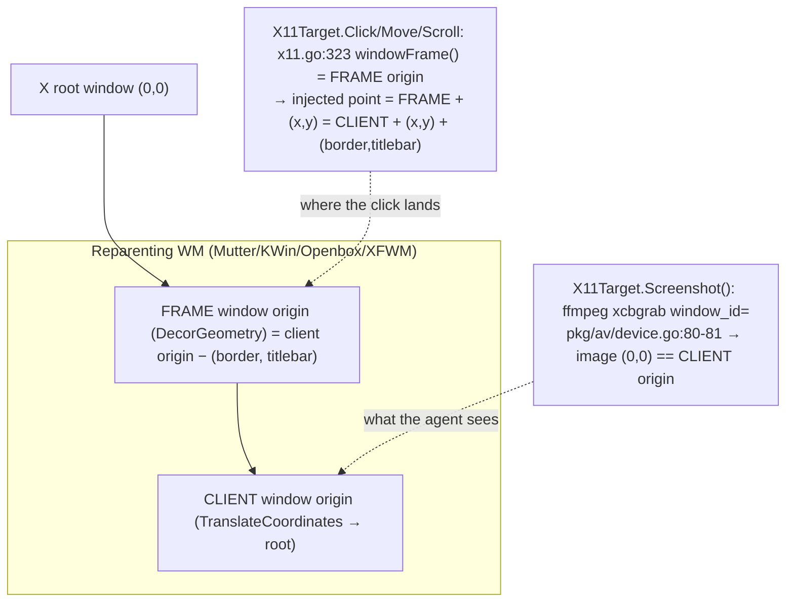

# ARCHITECTURE PLAN — X11 Coordinate & Automation Engine Fixes (PREREQUISITE)

**Slug:** `x11-coordinate-and-engine-fixes`
**Status:** Execute BEFORE `ARCHITECTURE_PLAN_automation-http-api.md` (that plan declares this as Phase 0).
**Repo root:** `/media/jang/home/Deve/zen-cap`

---

## Summary

Five defects in the existing X11 target and automation engine are not cosmetic: they are load-bearing for the upcoming `/automation` HTTP API. (1) A window-scoped `target.Target` captures the **client** drawable but injects input offset by the **WM frame** origin, so every `find_image → click` in a window-targeted run lands one title-bar + border too low/right — which is precisely the "screenshot → click → type" loop the agent API exists to serve. (2) Three polling actions never reach their own deadline check when capture fails, so a dead window produces an **infinite** FFmpeg-recapture loop. (3) `window: minimize` requests a WM-proprietary state and silently succeeds while doing nothing. (4) `window: geometry` bypasses the window manager, and its result is never read back or verified; three X error returns are discarded. (5) All XTEST input errors are dropped and coordinates are truncated to `int16` unchecked, so a click on a dead window returns HTTP-level success (today: YAML-level success).

This plan fixes those five, adds the two primitives the API plan needs (`ReleaseAllButtons`, a shared screen poller), and touches **no** HTTP surface.

### Dev loop (applies to every step below)

`./run.sh` watches sources (`POLL_MS=1000`, debounce `RUN_WATCH_DELAY_MS=4000`), rebuilds, and restarts `zen-cap service` on change; a build failure keeps the last good binary running. So: **edit → wait ~6s → probe. Never `go build` manually.**

Unit tests require the cgo/rpath env from `AGENTS.md` (dropping `-Wl,-rpath` yields `libavdevice.so.61/62: cannot open shared object`):

```bash
export FFMPEG_ROOT=/media/jang/home/Deve/zen-cap/ffmpeg8
export PKG_CONFIG_PATH="$FFMPEG_ROOT/lib/pkgconfig"
export CGO_CFLAGS="-I$FFMPEG_ROOT/include"
export CGO_LDFLAGS="-L$FFMPEG_ROOT/lib -Wl,-rpath-link,$FFMPEG_ROOT/lib -Wl,-rpath,\$ORIGIN/ffmpeg8/lib -Wl,-rpath,$FFMPEG_ROOT/lib -Wl,--disable-new-dtags"
go test ./pkg/automation/... ./pkg/target/... 2>&1 | tail -20
```

Live-X tests MUST self-skip: `if os.Getenv("DISPLAY") == "" { t.Skip("no X display") }`.

---

## Defect map

| ID | Defect | Locus | Severity |
|----|--------|-------|----------|
| F1 | window capture origin ≠ input origin (client vs `DecorGeometry`) | `pkg/target/x11.go:68-72` (capture) vs `pkg/target/x11.go:323-334` `windowFrame()` used by `Click:77-95`, `ButtonPress:97-112`, `ButtonRelease:114-127`, `Move:149-162`, `Scroll:284-316` | BLOCKER |
| F1b | `ScreenSize()` returns *screen* dims for a window target → `ParseRegion` shorthands (`finder.go:264-283`) mean nothing against the window image | `pkg/target/x11.go:52-57, 75` | MAJOR |
| F2 | capture-error `continue` skips the deadline check → unbounded poll loop | `pkg/automation/actions.go:489-494` (check at `:533`), `:578-582` (check `:628`), `:670-674` (check `:746`) | BLOCKER |
| F3 | `window: minimize` = `ewmh.WmStateReq(…, "_NET_WM_STATE_HIDDEN")`, ignored by most WMs; `fullscreen` does not clear maximized | `pkg/automation/actions.go:378-393` | MAJOR |
| F4 | `window: geometry` uses raw `xwindow.MoveResize` (client-relative vs frame-relative mismatch), return value discarded at `actions.go:438` (also `:404`, `:407`) | `pkg/automation/actions.go:411-440` | MAJOR |
| F5 | every `xtest.FakeInput` result dropped (`FakeInputCookie` never `.Check()`ed); coords silently truncated to `int16` | `pkg/target/x11.go:77-334` throughout | MAJOR |
| F6 | (missing primitive, needed by API plan) no way to force-release stuck pointer buttons | — | GAP |

### Coordinate spaces (the F1 problem in one picture)



Fix direction: **both sides use the client origin.** Capture already does; input must switch from `DecorGeometry()` to `xproto.TranslateCoordinates(client → root)`.

---

## Implementation Blueprint (fix plan)

| # | File path | Action | Concrete signature / schema (pseudocode) | Depends on | Acceptance criteria ("done when…") |
|---|-----------|--------|------------------------------------------|------------|-----------------------------------|
| 1 | `pkg/automation/poll.go` | **create** | `type outcome int` + `const (outDone outcome = iota; outMissed; outTimeout; outCaptureFailed)`<br>`type screenPoller struct { ctx *ExecContext; interval, deadline time.Duration; lastCapErr string }`<br>`func newScreenPoller(ctx *ExecContext, timeout, interval time.Duration) *screenPoller`<br>`// step captures one frame (cropping to regionStr) and calls fn; never loops itself.`<br>`func (p *screenPoller) step(regionStr string, fn func(haystack image.Image, offX, offY int) (bool, error)) (outcome, error)` | — | New test `pkg/automation/poll_test.go` with a `mockTarget` variant whose `Screenshot()` always returns an error: `newScreenPoller(ctx, 300*time.Millisecond, 50*time.Millisecond)` + a `fn` that never returns `true` reaches `outTimeout` in `300ms ≤ elapsed < 600ms` and issues ≤ 8 captures. `go vet ./pkg/automation/` clean. |
| 2 | `pkg/automation/actions.go` | **modify** | `runFindImage` (`:442-540`), `runFindText` (`:542-631`), `runOCR` (`:633-749`) each rewritten to: parse timeout (unchanged defaults: 10s at `:472-476`), then `poller := newScreenPoller(ctx, timeout, 500*time.Millisecond)` and a single `for { outcome, err := poller.step(step.Region, …); switch outcome { … } }`. Bodies of the match handlers stay as today (`ctx.LastFoundX/Y`, `then: click|move`, `output` PNG crop). | 1 | `TestFindImageCapturesFailTimeout` (add to `pkg/automation/actions_test.go`, reusing `mockTarget` at `actions_test.go:21` after step 3) asserts a capture-error target returns a `not found within timeout` error rather than hanging; `go test -timeout 60s ./pkg/automation/...` passes. |
| 3 | `pkg/automation/engine.go` | **modify** | `if_found` poll loop (`engine.go:262-330`) and `if_window` poll loop (`engine.go:421-478`) switch to the same `screenPoller` (`if_window` uses `poller` only for the deadline/sleep/abort cadence — its condition is not a screen capture). Preserve current semantics: `if_found` still takes `else` branch on timeout, returns no error. | 1, 2 | `TestIfFoundTimeout`/`TestIfWindow` (existing, `actions_test.go:261`, `:790`) still pass; `if_found` with `type: image` + broken `image:` path still yields the existing "failed to open template image" error (that error is NOT swallowed). |
| 4 | `pkg/target/x11.go` | **modify** | Replace `func (t *X11Target) windowFrame() (int, int)` (`:323-334`) with:<br>`func (t *X11Target) clientOrigin() (int, int, error)` — `xproto.TranslateCoordinates(t.xu.Conn(), xproto.Window(t.windowID), xproto.Window(t.xu.RootWin()), 0, 0).Reply()` → `(reply.DstX, reply.DstY)`; `windowID == 0` → `(0, 0, nil)`.<br>Call sites `Click:77-95`, `ButtonPress:97`, `ButtonRelease:114`, `Move:149`, `Scroll:284` now: `ox, oy, err := t.clientOrigin(); if err != nil { return err }` then add to x/y. | — | New live test `pkg/target/x11_live_test.go` `TestInputOffsetIsClientOrigin`: create an `override_redirect` test window via `xproto.ConfigureWindow` at root `(240, 180)`, map it; call `NewX11Target(Config{Display: os.Getenv("DISPLAY")}, winID)`; `Move(10, 20)`; then `xproto.QueryPointer(conn, root).Reply()` ⇒ root pointer coords must equal `(250, 200)` (client origin + requested offset), NOT `(240+border, 180+titlebar+border)`. Skips without `$DISPLAY`. |
| 5 | `pkg/target/x11.go` | **modify** | `NewX11Target` (`:34-58`): when `windowID != 0`, resolve and cache the client geometry (`xwindow.New(...).Geometry()`) into `t.w, t.h` so `ScreenSize()` (`:75`) returns **client** size for window targets; add `func (t *X11Target) IsWindowTarget() bool { return t.windowID != 0 }`. Screen dims stay for `windowID == 0`. | 4 | `TestScreenSizeWindowTarget` (live): create a 400×300 test window, assert `ScreenSize() == (400, 300)` and that `automation.ParseRegion("BR", w, h)` resolves against that, not against the monitor. |
| 6 | `pkg/target/x11.go` | **modify** | Add bounds+range validation and error propagation:<br>`func (t *X11Target) checkPoint(x, y int) error` — reject `x < -32768 \|\| x > 32767` (same for y) with `fmt.Errorf("x11: coordinate (%d,%d) outside int16 range", …)`; reject `windowID == 0 && (x < 0 \|\| x >= t.w …)` with `out of screen bounds`.<br>Every `xtest.FakeInput(...)` in `Click`, `ButtonPress`, `ButtonRelease`, `Move`, `Scroll` becomes `if err := xtest.FakeInputChecked(...).Check(); err != nil { return fmt.Errorf("x11: fake %s: %w", …, err) }`.<br>`Type` (`:164-232`) and `Key` (`:234-282`): propagate the per-key `Check()` errors instead of discarding them (keep the `time.Sleep(delayMs)` pacing and the `ActiveWindowReq` best-effort ignore). | 4 | `TestClickRejectsOutOfRange` (unit, no X needed for the range branch if `checkPoint` is called before any X call — put range check first): `NewX11Target` on live display, `Click(40000, 10, "left")` returns an error mentioning `int16`. `go build ./...` succeeds (no unused-symbol fallout from removing the old `windowFrame`). |
| 7 | `pkg/target/target.go` | **modify** | Add an **optional** capability interface (deliberately NOT added to `Target`, so `adb.go`/`vnc.go`/`wda.go` need no changes):<br>`type PanicReleaser interface { ReleaseAllButtons() error }`<br>Doc comment: "implemented by backends able to force-release pointer buttons; used to undo a stuck press after an aborted/failed gesture." | — | `go build ./...` passes; `pkg/automation` type-asserts with `if pr, ok := tgt.(target.PanicReleaser); ok { _ = pr.ReleaseAllButtons() }`. |
| 8 | `pkg/target/x11.go` | **modify** | `func (t *X11Target) ReleaseAllButtons() error` — `xproto.QueryPointer` for the current root pointer position, then `xtest.FakeInputChecked(ButtonRelease, btn)` for `btn ∈ {1,2,3}` at that position, ignoring `BadAccess`/no-op releases; single `conn.Sync()` before returning. | 6, 7 | Live test `TestReleaseAllButtonsRecoversStuckPress`: `ButtonPress(5,5,"left")`, then `ReleaseAllButtons()`, then `QueryPointer` + `QueryKeymap` (`xproto.QueryKeymap` → mask bit for button 1 = index 0…255 mapping) shows button 1 not held. Also: manual `xdotool mousedown 1`-equivalent is NOT required to reproduce; the test creates the stuck state itself. |
| 9 | `pkg/target/vfb.go` | **modify** | `func (t *VFBTarget) ReleaseAllButtons() error { if x := t.X11(); x != nil { return x.ReleaseAllButtons() } ; return nil }` so the VFB backend satisfies `PanicReleaser` too. | 7, 8 | `var _ target.PanicReleaser = (*target.VFBTarget)(nil)` compiles in `pkg/target/vfb_panicrelease_test.go` (or a `var _` assertion at the bottom of `vfb.go`). |
| 10 | `pkg/automation/window_ops.go` | **create** | All X11 window mutations, one home:<br>`type WindowGeom struct { X, Y, W, H int }`<br>`func CurrentGeometry(xu *xgbutil.XUtil, id uint32, decor bool) (WindowGeom, error)` (`decor` selects `DecorGeometry` vs `Geometry`, mirroring `pkg/display/x11.go:110-119`)<br>`func MoveWindow(xu *xgbutil.XUtil, id uint32, x, y int) error` → `ewmh.MoveWindow(xu, xproto.Window(id), x, y)` (`ewmh/ewmh.go:320`), with `xproto.ConfigureWindow` fallback when the WM lacks `_NET_MOVERESIZE_WINDOW` (`ewmh.Supported(xu, "MOVERESIZE_WINDOW", false)`)<br>`func ResizeWindow(xu *xgbutil.XUtil, id uint32, w, h int) error` → clear maximized first, then `xwindow.New(xu, w).MoveResize`<br>`func MinimizeWindow(xu *xgbutil.XUtil, id uint32) error` → `xproto.IconifyWindow(conn, xproto.Window(id)).Check()`<br>`func WaitForGeometry(xu *xgbutil.XUtil, id uint32, want WindowGeom, within time.Duration) (WindowGeom, error)` — poll `CurrentGeometry` every 50ms until equal (±2px) or timeout; error text embeds wanted vs actual<br>`func WaitForMapState(xu *xgbutil.XUtil, id uint32, want byte, within time.Duration) error` (uses `xproto.GetWindowAttributes(...).MapState`, compare against `MapStateViewable` / `MapStateIconic` — pattern from `pkg/display/x11.go:93-97`) | — | `go build ./...` clean. New live test `pkg/automation/window_ops_live_test.go`: create a test window at `(300,300) 320x240`; `MoveWindow(..., 500, 400)` + `WaitForGeometry` ⇒ `W==nil` and reported geometry ≈ requested; `MinimizeWindow` + `WaitForMapState(MapStateIconic)` ⇒ no error. On a WM that ignores the request the test must FAIL (that is the point: today it reports success). |
| 11 | `pkg/automation/actions.go` | **modify** | `runWindow` (`:357-441`) re-implemented on top of step 10 (no X code inline anymore):<br>`"minimize"` → `MinimizeWindow` + `WaitForMapState(..., xproto.MapStateIconic, 500ms)`; error ⇒ return error (no more silent 200-equivalent).<br>`"fullscreen"` → clear maximized (`WmStateReqExtra(…, 0, "_NET_WM_STATE_MAXIMIZED_HORZ"/"_VERT", 1)`) then set `_NET_WM_STATE_FULLSCREEN`, then verify via `_NET_WM_STATE` read (`ewmh.WmStateGet`, `ewmh/ewmh.go:845`).<br>`"restore"` → unchanged sequence + verify `MapStateViewable`.<br>`"geometry"` → `x`/`y` via `MoveWindow`, `w`/`h` via `ResizeWindow`, then `WaitForGeometry`; the previously-discarded errors at `:404/:407/:438` are returned.<br>Set `ctx.LastResult` (field added in the API plan step; until then, return the actual geometry in the error/log text) so callers can read back what the WM really did. | 10 | `TestWindowActionErrors` (`actions_test.go:776`) and `TestWindowActionsMocked` (`:837`) still pass; new `TestWindowGeometryReportsMismatch` using a fake target/`stubXUtil`-free path: when `WaitForGeometry` times out, `runWindow` returns an error containing both requested and actual numbers. |
| 12 | `pkg/target/x11.go`, `pkg/display/x11.go` | **modify (docs only)** | Update the `windowFrame`→`clientOrigin` comment block (`x11.go:317-322`) so it no longer claims the decorated frame is the right offset for input, and state the invariant: **capture and input share the client-area space; `pkg/display`'s frame-relative listing stays as-is for window-picker UIs** (`pkg/display/x11.go:110-119`). | 4 | `grep -rn "windowFrame" pkg/` returns nothing; comment explains client vs frame and points at `TranslateCoordinates`. |
| 13 | `AUTOMATION_API.md` | **modify** | (a) Fix the false claim that `scroll` exists as an action (`AUTOMATION_API.md:43` lists it; `ExecuteStep` at `actions.go:48-94` has no `scroll` case — it becomes true only in the API plan). Until the API plan lands, mark it **planned**. (b) Add a `## Coordinate space` section: window-scoped runs address the **client area**, `(0,0)` = client top-left, screenshots and clicks agree; full-screen runs address root space. (c) Correct `window` mode docs (`:467-483`) for `minimize`/`geometry` verification semantics. | 11 | Doc no longer advertises `scroll` as implemented; a reader can state, from the doc alone, which origin `(0,0)` refers to for a window-targeted script. |
| 14 | `AGENTS.md` | **modify** | Append a "Dev loop" subsection recording: `./run.sh` auto-rebuild+restart semantics (`RUN_WATCH_DELAY_MS` 4000ms debounce), "never `go build` by hand", and the mandatory `CGO_LDFLAGS`/`-rpath` note from this plan. | — | A new agent following only `AGENTS.md` runs `go test ./pkg/automation/...` successfully on the first try. |

---

## Build sequence & verification

| Step | Touches | Verify |
|------|---------|--------|
| 1 → 2 → 3 | `poll.go`, `actions.go`, `engine.go` | `go test ./pkg/automation/...` (pure-Go logic, no X required) + the capture-error timeout test from step 1/2 |
| 4 → 5 → 6 | `pkg/target/x11.go` | `go test ./pkg/target/... -run 'Live'` with `$DISPLAY` set; then a manual end-to-end: run an existing window-targeted script from `automations/` (or a temp one with `window: {title: "…"} → find_image → click`) and confirm the click now lands on the template |
| 7 → 8 → 9 | `pkg/target/{target,x11,vfb}.go` | live `TestReleaseAllButtonsRecoversStuckPress` |
| 10 → 11 | `window_ops.go`, `actions.go` | live window-ops test + existing automation suite green |
| 12 → 13 → 14 | comments, docs | `grep` checks in each row |

**Regression gate for the whole plan:** the pre-existing suite `go test ./pkg/automation/...` (currently `ok zen-cap/pkg/automation 0.159s`) must stay green at every step; `pkg/target` has no tests today, so the new live tests are its first coverage — they must self-skip headless.

---

## Behavior changes visible to existing YAML scripts (call these out in the commit message)

1. Window-targeted clicks/moves shift by (border, titlebar) — **they become correct**; any script hand-tuned with a negative `offset_y` to compensate needs that offset removed.
2. `region` on window targets now interprets `TL/BR` etc. against client size, not monitor size.
3. `window: minimize` / `window: geometry` now **fail loudly** when the WM ignores the request instead of reporting success.
4. Input on a dead/unusable window now returns an X error instead of `nil`.

---

## Key decisions (fix plan)

| Decision | Alternative considered | Why rejected |
|---|---|---|
| Input offset = client origin via `TranslateCoordinates` | Keep `DecorGeometry` and add a `coordinate_space: "client"\|"frame"` per-run switch | Two coordinate spaces doubles the docs, the tests, and every future bug report; the current behavior is simply wrong for the capture path that feeds it |
| `PanicReleaser` as an optional interface type-asserted at the call site | Add `ReleaseAllButtons()` to the `Target` interface (`pkg/target/target.go:20-44`) | Forces 4 unrelated backends (`adb.go`, `vnc.go`, `wda.go`, `vfb.go`) to implement something ADB/WDA cannot express cleanly (no release-only primitive); optional interface keeps the compile-time surface honest |
| Shared `screenPoller` used by 4 poll sites (`find_image`, `find_text`, `ocr`, `if_found`) | Patch each `continue` in place | The three sites disagree today (capture error swallowed at `engine.go:262-300` vs infinite loop at `actions.go:489-494`) — a helper removes the divergence class, which is exactly what the API plan inherits |
| WM-correct `ewmh.MoveWindow` with raw `ConfigureWindow` fallback | Always `xwindow.MoveResize` | Raw configure is overridden by reparenting WMs for managed windows and produces the frame/client mismatch this plan is removing; EWMH is the only protocol-correct path, with fallback documented for non-EWMH WMs (i3 etc.) |
| Verify-by-read-back (`WaitForGeometry`, `WaitForMapState`) | Fire the request and return | `ewmh.WmStateReq`/`ActiveWindowReq` return when the request is *sent*, not when the WM acts (`actions.go:378-393`) — an agent needs "did the window actually go fullscreen?" as a boolean, not a hope |

---

## Handoff to the API plan

After this lands, `ARCHITECTURE_PLAN_automation-http-api.md` may assume:
- `target.PanicReleaser` exists for the `/automation/abort` path (its step 10).
- `screenPoller` (`pkg/automation/poll.go`) is the only polling primitive — its `wait_until` action builds on it.
- Window-scoped `Screenshot()` + `Click()` agree on the client area, which is the premise of its `/automation/screenshot` + `click` ergonomics.
- Its `window_state` read-back action can reuse `pkg/automation/window_ops.go: CurrentGeometry` rather than re-deriving geometry.
